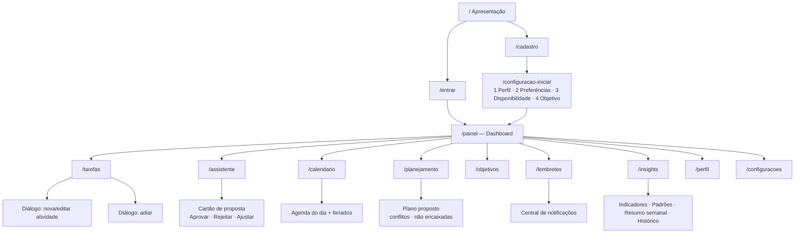
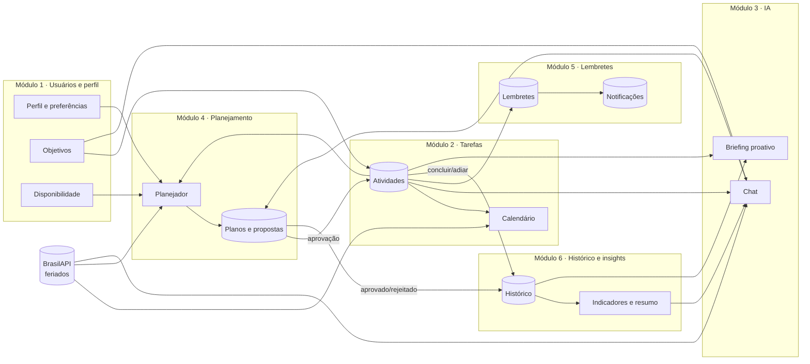
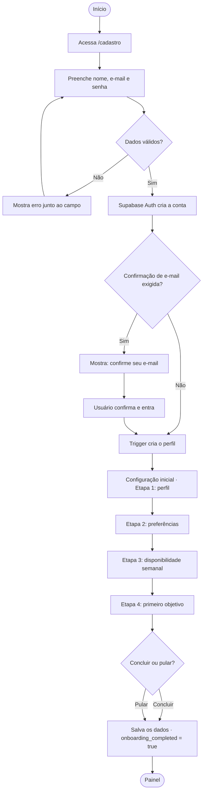
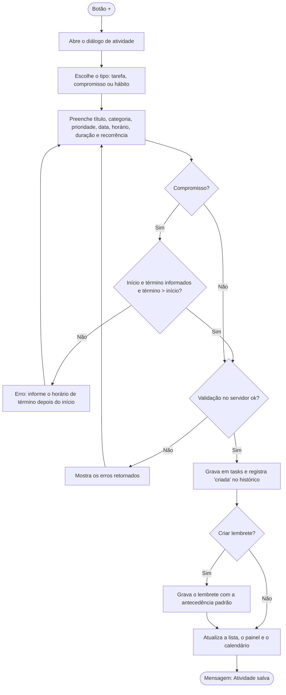
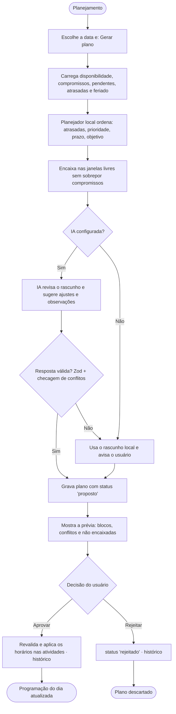
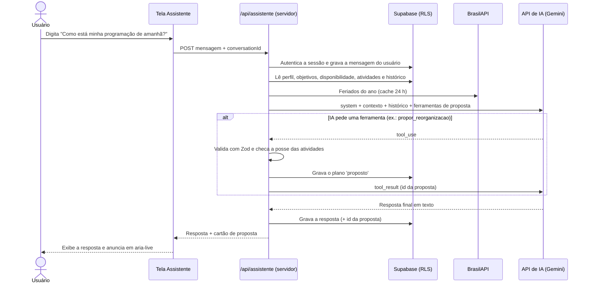
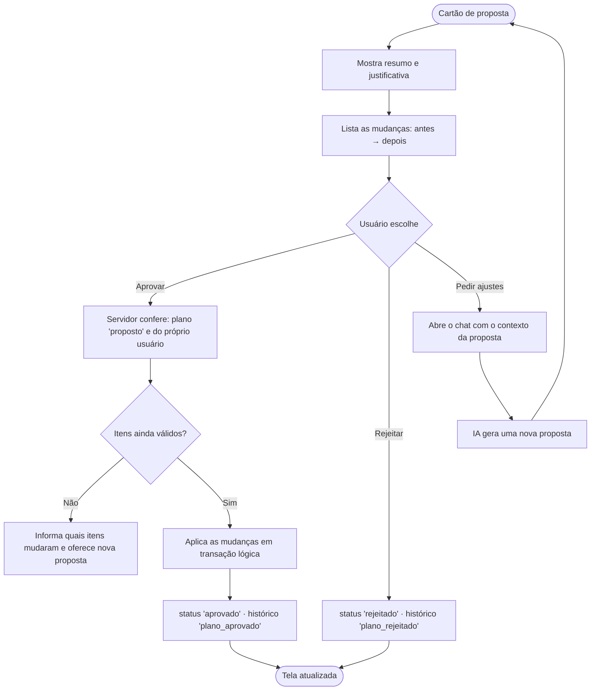
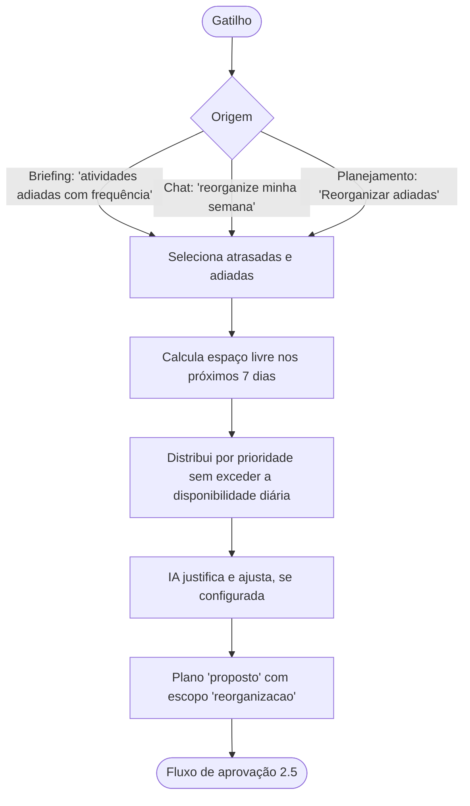
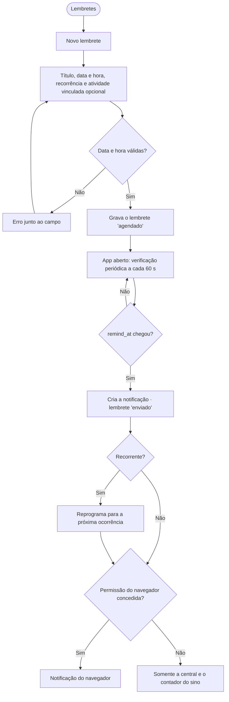
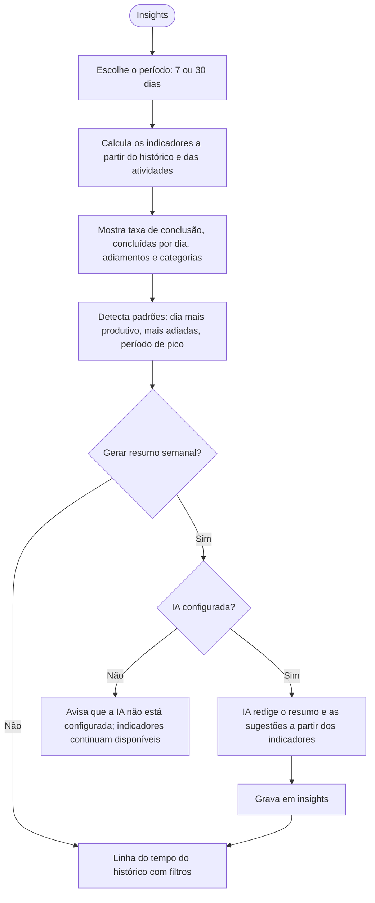

# Etapa 3 — Wireframes e Prototipação

> Entregáveis da apostila (seção 1.4): arquitetura de informação, fluxogramas, wireframes de baixa fidelidade e protótipo navegável de média/alta fidelidade.
> O projeto visual está no Figma. O link e a organização das páginas estão na [seção 5](#5-projeto-no-figma).

---

## 1. Arquitetura da informação

### 1.1 Estrutura de navegação

O NEXO tem duas áreas: **pública** (apresentação, entrar e cadastro) e **autenticada** (as funcionalidades). A navegação principal tem cinco destinos fixos e um menu "Mais" para os destinos secundários. A ordem é a mesma em todas as faixas de tela (heurística H4).

| Prioridade | Destino | Rota | Celular (≤ 768 px) | Tablet grande (769–1024 px) | Desktop (≥ 1025 px) |
|---|---|---|---|---|---|
| Primária | Painel | `/painel` | Barra inferior | Barra lateral (ícones) | Barra lateral (ícone + texto) |
| Primária | Tarefas | `/tarefas` | Barra inferior | Barra lateral | Barra lateral |
| Primária | Assistente | `/assistente` | Barra inferior (botão central em destaque) | Barra lateral | Barra lateral |
| Primária | Calendário | `/calendario` | Barra inferior | Barra lateral | Barra lateral |
| Primária | Mais | — | Barra inferior (abre a gaveta) | — | — |
| Secundária | Planejamento | `/planejamento` | Gaveta "Mais" | Barra lateral | Barra lateral |
| Secundária | Objetivos | `/objetivos` | Gaveta "Mais" | Barra lateral | Barra lateral |
| Secundária | Lembretes e notificações | `/lembretes` | Gaveta "Mais" + sino no topo | Barra lateral + sino | Barra lateral + sino |
| Secundária | Insights e histórico | `/insights` | Gaveta "Mais" | Barra lateral | Barra lateral |
| Conta | Perfil | `/perfil` | Gaveta "Mais" | Barra lateral (rodapé) | Barra lateral (rodapé) |
| Conta | Configurações | `/configuracoes` | Gaveta "Mais" | Barra lateral (rodapé) | Barra lateral (rodapé) |

### 1.2 Mapa de telas (hierarquia)

### 1.3 Organização dos módulos e relação entre as funcionalidades

Todos os módulos leem e gravam **as mesmas tabelas**. O diagrama mostra o fluxo de dados entre eles.

### 1.4 Estrutura do dashboard (`/painel`)

Ordem de leitura (igual em todas as faixas; no desktop vira grade de 12 colunas):

1. **Saudação e data**: "Boa tarde, Camila · segunda-feira, 23 de novembro" e o próximo feriado.
2. **Briefing do NEXO** (assistente proativo): até 3 recomendações com ação ("Ver programação", "Reorganizar tarde").
3. **Agora e a seguir**: atividades das próximas 2 horas (RF36).
4. **Programação de hoje**: linha do tempo do dia (RF18).
5. **Resumo rápido**: pendentes hoje, atrasadas, concluídas na semana e taxa de conclusão.
6. **Objetivos em foco**: até 3 objetivos com barra de progresso.
7. **Ação flutuante "+"**: nova atividade.

| Faixa | Grade do painel |
|---|---|
| 320–480 px | 1 coluna, cartões empilhados |
| 481–768 px | 1 coluna; o resumo rápido em 2×2 |
| 769–1024 px | 2 colunas (programação à esquerda; briefing, resumo e objetivos à direita) |
| 1025–1200 px | 2 colunas mais largas; resumo em 4 colunas |
| ≥ 1201 px | 3 colunas (briefing · programação · resumo e objetivos), com largura máxima de 1440 px |

### 1.5 Fluxos principais de utilização

| Fluxo | Caminho | Requisitos |
|---|---|---|
| Primeiro acesso | Apresentação → Cadastro → Configuração inicial → Painel | RF01, RF03–RF07 |
| Registrar atividade | Qualquer tela → "+" → formulário → salvar → lista e painel atualizados | RF09, RF15, RF34 |
| Planejar o dia | Planejamento → "Gerar plano de hoje" → revisar conflitos → aprovar | RF26–RF30 |
| Conversar com a IA | Assistente → pergunta → resposta com dados reais | RF19–RF22 |
| Aprovar recomendação | Proposta (chat, briefing ou planejamento) → prévia → aprovar, rejeitar ou ajustar | RF23–RF24 |
| Reorganizar a rotina | Alerta de adiamentos → "Reorganizar" → proposta → aprovação | RF31, RF25 |
| Configurar lembrete | Lembretes → "Novo lembrete" → data, hora e recorrência → central de notificações | RF33–RF38 |
| Consultar insights | Insights → indicadores → padrões → "Gerar resumo semanal" | RF39–RF44 |

---

## 2. Fluxogramas

Diagramas em Mermaid (renderizados no GitHub). As mesmas versões estão na página **02 · Arquitetura** do Figma.

### 2.1 Cadastro e configuração inicial

### 2.2 Registro de tarefa

### 2.3 Planejamento diário

### 2.4 Conversa com a IA

### 2.5 Aprovação de recomendações

### 2.6 Reorganização da rotina

### 2.7 Configuração de lembretes

### 2.8 Consulta de insights

---

## 3. Wireframes de baixa fidelidade

Os wireframes estão na página **03 · Wireframes** do Figma, em escala de cinza, priorizando a organização dos blocos e a navegação. Abaixo, a estrutura de cada tela (mobile, 360 px):

| Tela | Estrutura (de cima para baixo) |
|---|---|
| Entrar | Logotipo · título · e-mail · senha · botão "Entrar" · link "Criar conta" |
| Cadastro | Logotipo · título · nome · e-mail · senha (com regra) · botão · link "Já tenho conta" |
| Configuração inicial | Indicador de etapa (1/4) · título da etapa · campos · "Pular" + "Continuar" |
| Painel | Topo (saudação, sino) · briefing · agora/a seguir · programação · resumo 2×2 · objetivos · "+" · barra inferior |
| Tarefas | Topo · busca · filtros (chips) · seções Atrasadas/Hoje/Próximas/Sem data · cartões com checkbox e menu · "+" |
| Objetivos | Topo · "+ Objetivo" · cartões com progresso, prazo e nº de atividades |
| Calendário | Mês (grade 7 colunas) com pontos e feriados · agenda do dia selecionado |
| Assistente | Topo com conversas · mensagens · sugestões rápidas · campo e "Enviar" |
| Planejamento | Seletor Dia/Semana · data · "Gerar plano" · blocos de horário · conflitos · não encaixadas · Aprovar/Rejeitar |
| Lembretes | Abas Lembretes/Notificações · lista · "+ Lembrete" |
| Insights | Período · 4 indicadores · gráfico de barras · padrões · resumo semanal · histórico |
| Perfil | Dados pessoais · preferências · disponibilidade semanal |
| Configurações | Aparência (tema) · notificações · segurança (senha) · dados e IA · sair |

## 4. Protótipo navegável

O protótipo de alta fidelidade (página **07 · Protótipo** do Figma) conecta as telas mobile nos fluxos:

1. Entrar → Painel.
2. Painel → Tarefas → nova atividade → Tarefas.
3. Painel → Assistente → proposta → aprovação → Painel.
4. Painel → Planejamento → aprovar → Painel.
5. Barra inferior: navegação entre Painel, Tarefas, Assistente, Calendário e Mais.

## 5. Projeto no Figma

Arquivo: **NEXO — Assistente Pessoal Inteligente**. O link real está registrado no [README](../README.md#figma).

| Página | Conteúdo |
|---|---|
| 01 · Identidade visual | Logotipo, paleta (claro/escuro), tipografia, ícones, botões, campos, componentes e estados |
| 02 · Arquitetura | Navegação, mapa de telas e organização dos módulos |
| 03 · Wireframes | Baixa fidelidade das telas principais |
| 04 · Mobile | 11 telas a 390 px |
| 05 · Tablet | Telas principais a 768 px |
| 06 · Desktop | Telas principais a 1440 px |
| 07 · Protótipo | Telas mobile conectadas com interações de clique |
