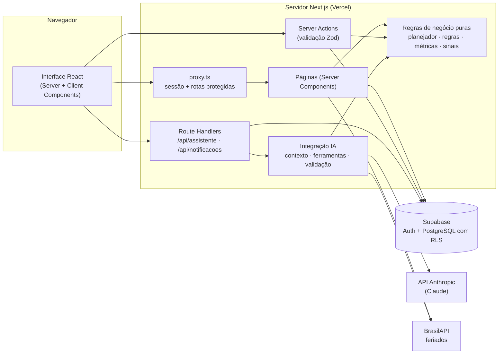
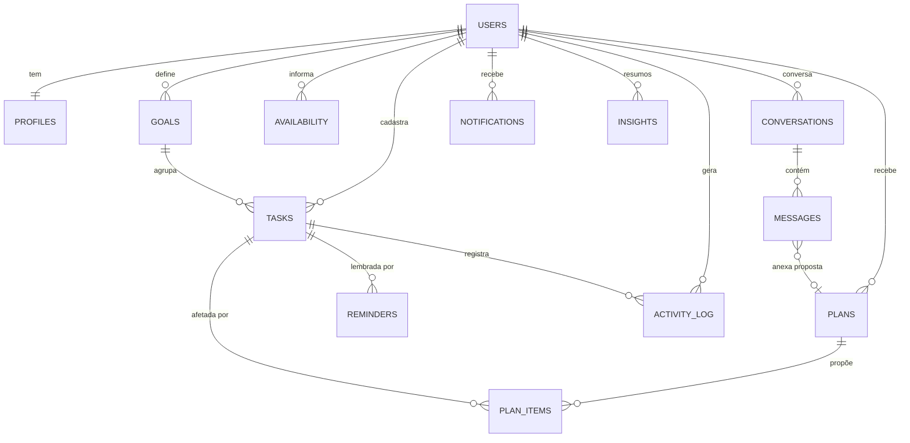

# Arquitetura da Aplicação

## 1. Visão geral



- **Interface** (`src/app`, `src/components`): telas e componentes. Não acessa o banco nem a IA diretamente.
- **Regras de negócio** (`src/lib/tasks/rules.ts`, `src/lib/planning/scheduler.ts`, `src/lib/insights/*.ts`, `src/lib/ai/proposals.ts`): funções **puras**, sem acesso a rede, cobertas por testes unitários.
- **Persistência** (`src/lib/*/queries.ts`, `src/lib/*/actions.ts`, `supabase/migrations`): consultas e Server Actions sobre o Supabase. O isolamento entre usuários é garantido pelo **Row Level Security**.
- **Serviços externos** (`src/lib/holidays/brasilapi.ts`, `src/lib/ai/client.ts`): BrasilAPI e Anthropic, com tempo limite e tratamento de erros.
- **Integração com IA** (`src/lib/ai/*`): monta o contexto autorizado, define as ferramentas e valida tudo o que a IA propõe antes de gravar.

## 2. Tecnologias

| Camada | Tecnologia | Versão | Motivo |
|---|---|---|---|
| Framework | Next.js (App Router, Turbopack) | 16.4.6 | Front-end e back-end no mesmo projeto; Server Actions; deploy nativo na Vercel |
| UI | React | 19.3 | Componentes, `useActionState` e `useFormStatus` para formulários acessíveis |
| Linguagem | TypeScript (strict) | 5.9 | Contratos entre módulos e menos erros em equipe |
| Estilos | CSS puro com variáveis, Grid, Flexbox e media queries | — | Demonstra os conceitos da apostila sem framework extra |
| Banco e autenticação | Supabase (PostgreSQL + Auth) — `@supabase/ssr`, `@supabase/supabase-js` | 0.12.7 / 2.119.2 | Banco relacional gerenciado, autenticação pronta e RLS |
| IA | API Anthropic (Claude) — `@anthropic-ai/sdk` | 1.12.0 | Chamadas pelo servidor, ferramentas e saída estruturada |
| Validação | Zod | 4.6.7 | Mesmos esquemas para formulários e respostas da IA |
| API pública | BrasilAPI — feriados nacionais | v1 | Gratuita, sem chave, dados brasileiros |
| Testes | Vitest, PGlite, Playwright, axe-core, Lighthouse | 4.1 / 0.5 / 1.65 / 4.14 / 13.6 | Unitários, banco real (RLS), E2E, acessibilidade e desempenho |
| Hospedagem | Vercel + Supabase Cloud | — | Plano gratuito para projetos acadêmicos |

Versões conferidas no registro npm em 23/11/2026. **Não foram adicionadas** bibliotecas de UI, de ícones (os ícones são SVG próprios, iguais aos do Figma), de estado global nem ORM.

### Decisões técnicas

1. **`cacheComponents: false`** em `next.config.ts`: todas as telas autenticadas leem a sessão a cada requisição; o modelo clássico de renderização dinâmica é mais simples de manter por cinco integrantes.
2. **CSS sem framework**: os tokens de cor e espaçamento são variáveis CSS idênticas às variáveis do Figma; os breakpoints são exatamente os da apostila (`481`, `769`, `1025`, `1201` px, com `min-width`).
3. **Planejador local + IA**: o encaixe de horários é um algoritmo determinístico e testado. A IA revisa o rascunho, sugere melhorias e conversa, mas toda saída dela é validada e só vira **proposta**. Assim o planejamento funciona mesmo sem a IA, e a IA nunca grava dados inválidos.
4. **Aprovação transacional no banco**: `public.approve_plan()` (PL/pgSQL, `security invoker`) aplica todos os itens de uma proposta numa única transação, respeitando o RLS.
5. **Modelo de IA configurável** por `ANTHROPIC_MODEL` (padrão `claude-haiku-5-5`, escolhido pelo grupo por custo e velocidade; `claude-opus-5-5` pode ser usado para respostas mais elaboradas).

## 3. Estrutura de pastas

```text
nexo/
├── docs/                         # Documentação acadêmica e técnica
├── supabase/migrations/          # SQL: tabelas, RLS, gatilhos, approve_plan
├── src/
│   ├── app/
│   │   ├── page.tsx              # Apresentação (pública)
│   │   ├── entrar/ cadastro/     # Autenticação
│   │   ├── configurar/           # Instruções quando faltam variáveis de ambiente
│   │   ├── auth/confirm/         # Confirmação de e-mail (Supabase)
│   │   ├── (onboarding)/configuracao-inicial/
│   │   ├── (app)/                # Área autenticada (layout com navegação)
│   │   │   ├── painel/ tarefas/ calendario/ planejamento/ assistente/
│   │   │   └── objetivos/ lembretes/ insights/ perfil/ configuracoes/
│   │   └── api/
│   │       ├── assistente/route.ts   # Chat com a IA
│   │       └── notificacoes/route.ts # Lembretes vencidos → notificações
│   ├── components/
│   │   ├── ui/                   # Design system: Icon, Logo, Field, Dialog, Toast...
│   │   ├── layout/               # Navegação (menu lateral, barra inferior), sino, criação rápida
│   │   ├── tasks/ planning/ assistant/ goals/ reminders/ profile/ dashboard/ auth/
│   ├── lib/
│   │   ├── types.ts              # Contratos de dados compartilhados
│   │   ├── dates.ts              # Datas e fuso horário
│   │   ├── validation/schemas.ts # Zod
│   │   ├── supabase/             # Clientes do servidor e do proxy
│   │   ├── auth/ profile/        # Módulo 1
│   │   ├── tasks/                # Módulo 2
│   │   ├── ai/                   # Módulo 3
│   │   ├── planning/             # Módulo 4
│   │   ├── reminders/            # Módulo 5
│   │   ├── insights/ history/    # Módulo 6
│   │   ├── holidays/brasilapi.ts # API pública
│   │   └── snapshot.ts           # Carrega os MESMOS dados para Painel, IA, Planejamento e Insights
│   ├── styles/                   # tokens, base, layout, componentes, páginas
│   └── proxy.ts                  # (antigo middleware) sessão e rotas protegidas
└── tests/
    ├── unit/                     # Regras puras (Vitest)
    ├── db/                       # Migração + RLS + approve_plan (PGlite)
    ├── integration/              # BrasilAPI real
    └── e2e/                      # Playwright + axe (responsividade e acessibilidade)
```

## 4. Modelo de dados



| Tabela | Finalidade | Principais regras |
|---|---|---|
| `profiles` | Perfil, preferências e tema | Criado por gatilho no cadastro; o usuário só lê e atualiza o próprio |
| `goals` | Objetivos | Progresso 0–100; status ativo/concluído/pausado |
| `availability` | Janelas livres por dia da semana | `end_time > start_time` |
| `tasks` | Tarefas, compromissos e hábitos | Compromisso exige horário; término > início; `completed_at` coerente com o status |
| `activity_log` | Histórico | Somente leitura e inserção pelo usuário (sem edição nem exclusão) |
| `conversations`, `messages` | Chat com a IA | Mensagem só em conversa do próprio usuário |
| `plans`, `plan_items` | Planos e propostas (prévia antes → depois) | Status proposto/aprovado/rejeitado; aprovação via `approve_plan` |
| `reminders` | Lembretes | Recorrência diária/semanal; tarefa vinculada precisa ser do usuário |
| `notifications` | Central de notificações | Links apenas internos (`/…`); deduplicação por chave |
| `insights` | Briefing diário e resumo semanal | Um por usuário, tipo e período |

## 5. Segurança e privacidade

| Ameaça | Mitigação |
|---|---|
| Usuário acessar dados de outro | RLS em **todas** as tabelas; chaves estrangeiras também conferidas contra o dono; **testado** em `tests/db/schema-rls.test.ts` |
| Visitante sem login | O papel `anon` não tem permissão em nenhuma tabela; o proxy redireciona as rotas protegidas; `requireUser()` em toda página e ação |
| Chave da IA exposta | `ANTHROPIC_API_KEY` só existe no servidor (sem prefixo `NEXT_PUBLIC_`) e o cliente é criado em módulo `server-only` |
| IA gravando dados indevidos | A IA só **propõe**; `validateProposal` confere posse, datas, horários e conflitos; a aprovação revalida no banco |
| Links maliciosos vindos da IA | `isAllowedActionHref` aceita apenas rotas internas conhecidas; a coluna `notifications.link` exige `/…` |
| Redirecionamento aberto | O parâmetro `next`/`proxima` só aceita caminhos internos |
| Clickjacking e afins | Cabeçalhos `X-Frame-Options: DENY`, `X-Content-Type-Options: nosniff`, `Referrer-Policy` e `Permissions-Policy`; sem `X-Powered-By` |
| Credenciais no repositório | `.env*` no `.gitignore` (exceto `.env.example`, que não tem valores) |

**Dados enviados à IA** (ver `src/lib/ai/context.ts`): nome, ocupação, preferências, objetivos, disponibilidade, atividades pendentes e concluídas recentemente, indicadores de 7 dias, feriados e alertas. **Nunca** são enviados e-mail, senha ou IDs de autenticação; isso é coberto por teste unitário.

## 6. Integração com IA (Módulo 3)

| Recurso | Arquivo | Como funciona |
|---|---|---|
| Chat | `src/app/api/assistente/route.ts`, `src/lib/ai/chat.ts` | Envia o prompt de sistema (em cache), o contexto do usuário e as últimas 20 mensagens; laço de até 5 rodadas de ferramentas |
| Ferramenta `consultar_planejador` | `chat.ts` | Somente leitura: devolve horários livres, compromissos e o rascunho do planejador local |
| Ferramenta `propor_alteracoes` | `chat.ts`, `proposals.ts` | Cria uma **proposta** (`plans` + `plan_items`) depois da validação; com erro, devolve a mensagem para a IA corrigir |
| Briefing proativo | `src/lib/insights/service.ts`, `structured.ts` | Sinais por regras → texto personalizado pela IA (JSON validado); no máximo uma vez por dia |
| Revisão do plano | `src/lib/planning/service.ts` | A IA reordena os blocos e escreve observações; os blocos passam por `validateBlocks` |
| Resumo semanal | `src/lib/insights/service.ts` | Métricas reais → resumo, destaques e sugestões (JSON validado) |

Sem `ANTHROPIC_API_KEY`, o chat mostra que a IA não está configurada e **não simula respostas**. O briefing, o planejamento e o resumo usam as regras locais e são identificados como "regras".

## 7. API pública — BrasilAPI (RF45)

- Endpoint: `GET https://brasilapi.com.br/api/feriados/v1/{ano}`, consultado de verdade em 23/11/2026 (14 feriados em 2026; ano inválido → 404).
- Implementação: `src/lib/holidays/brasilapi.ts`, com tempo limite de 8 s, validação Zod, cache de 24 h (`next.revalidate`) e mensagens de erro amigáveis.
- Uso: calendário (marcação e lista do mês), painel (próximo feriado), planejamento (observação quando o dia é feriado) e contexto da IA.

## 8. Lembretes e notificações (Módulo 5)

Enquanto o NEXO está aberto, o sino (`NotificationBell`) chama `POST /api/notificacoes` a cada 60 s. O servidor transforma lembretes vencidos em notificações (e reprograma os recorrentes) e cria no máximo um aviso diário de atividades atrasadas. Com permissão do usuário, as novas notificações também aparecem como **notificação do navegador**. Limitação desta versão: não há *push* com o aplicativo fechado (exigiria service worker e servidor de push).
